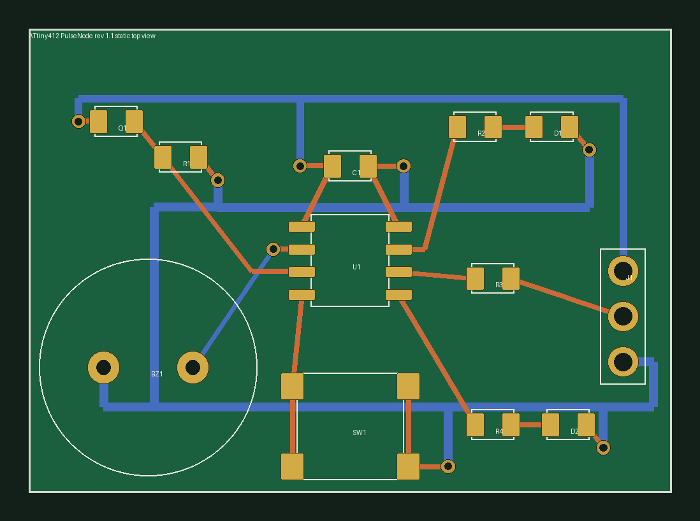

# ATtiny412 PulseNode Build Journal

## November 25, 2026 - Completed the rev 1.1 PCB layout and static manufacturing audit

The October 24 board was only partial: 4 of 12 BOM parts were placed and 3 supply joins were open. Rev 1.1 completes the design rather than presenting that partial board as orderable. All 12 BOM parts are now placed inside the 36x26mm outline, the series resistors are correctly inserted in the PWM LED, status LED and UPDI chains, the phototransistor and pull-down share the `PA7_LDR` node, and the piezo, button, power and ground connections are routed.

The board uses 45 copper segments and 8 vias across two copper layers. The local static audit reports 33 component pads, 11 named nets, 0 unrouted joins, 0 single-pad nets, minimum unlike-net copper clearance of 0.636mm and minimum board-edge copper clearance of 0.700mm. Gerbers, the Excellon drill file, the PCB JSON model and the STEP envelope assembly were regenerated from the completed KiCad PCB. This is a static design artifact only; it has not been fabricated or electrically tested.

## October 24, 2026 - Designed ATtiny412 schematic, 2-layer PCB, and Gerbers (5.0h)

Designed the first 36x26mm 2-layer PCB in KiCad 8 around the 8-pin ATtiny412-SSNR SOIC-8 microcontroller. That first pass placed only `U1`, `C1`, `D1` and `J1`, left the remaining BOM parts off the board, and left 3 connections on `+5V` and `GND` unrouted. It was useful as a pinout and floorplan draft, but it was not a finished order package.
