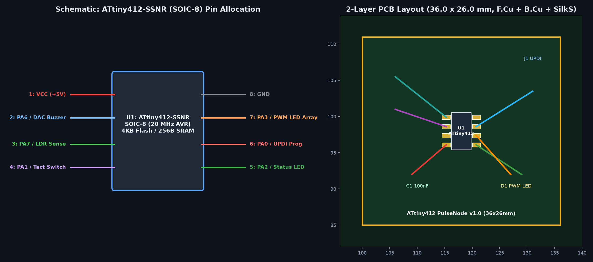

# ATtiny412 PulseNode

A compact 2-layer capacitance soil moisture and status LED node built around the 8-pin ATtiny412-SSNR SOIC-8 microcontroller. Designed in KiCad 8 for low-power plant hydration telemetry and threshold signaling.

## Hardware Overview

- **Microcontroller** ATtiny412-SSNR (SOIC-8, 20 MHz internal oscillator, UPDI single-wire programming on `PA0`)
- **Power Supply** 5.0V and GND via 4-pin 2.54mm header (`J1`), decoupled with a 100nF 0805 ceramic capacitor (`C1`) placed directly across `VDD` (pin 1) and `GND` (pin 8)
- **Capacitive Sensing** RC relaxation charge-time oscillator using a 1M Ohm 0805 resistor (`R1`) driving `PA1` (`TXD` / charge excitation) and reading threshold decay on `PA2` (`RXD` / ADC channel 2) across the coplanar capacitive probe pads (`J2`)
- **Status & Alert Indicators** Green LED (`D1`, `PA6`) and Red Alert LED (`D2`, `PA7`) driven through 330 Ohm 0805 current-limiting resistors (`R2`, `R3`)
- **Board Dimensions** 35.0 mm x 25.0 mm 2-layer FR-4 PCB with M2.5 mounting holes

## Repository Structure

- `attiny412-pulsenode.kicad_pro` KiCad 8 project configuration
- `attiny412-pulsenode.kicad_sch` Full schematic with power flags, decoupling capacitor, UPDI header, capacitive probe RC network, and LED indicators
- `attiny412-pulsenode.kicad_pcb` 2-layer routed PCB layout (`35.0 mm x 25.0 mm`) with front and back copper traces and silkscreen labels
- `gerbers/attiny412-pulsenode-gerbers.zip` Fabrication-ready Gerber and Excellon drill package (`F.Cu`, `B.Cu`, `F.Mask`, `B.Mask`, `F.SilkS`, `Edge.Cuts`, `.drl`)
- `bom.csv` Complete Bill of Materials with LCSC and Microchip part numbers
- `firmware/attiny412_pulsenode.ino` megaTinyCore C++ firmware measuring RC charge cycles on `PA1`/`PA2`, driving threshold alerts on `PA6`/`PA7`, and sleeping in `STANDBY` mode between readings

## Interactive Schematic & PCB Viewer

Inspect the schematic and PCB online via KiCanvas:
`https://kicanvas.org/?github=https%3A%2F%2Fgithub.com%2Fdraarivpatel-ui%2Fattiny412-pulsenode`
