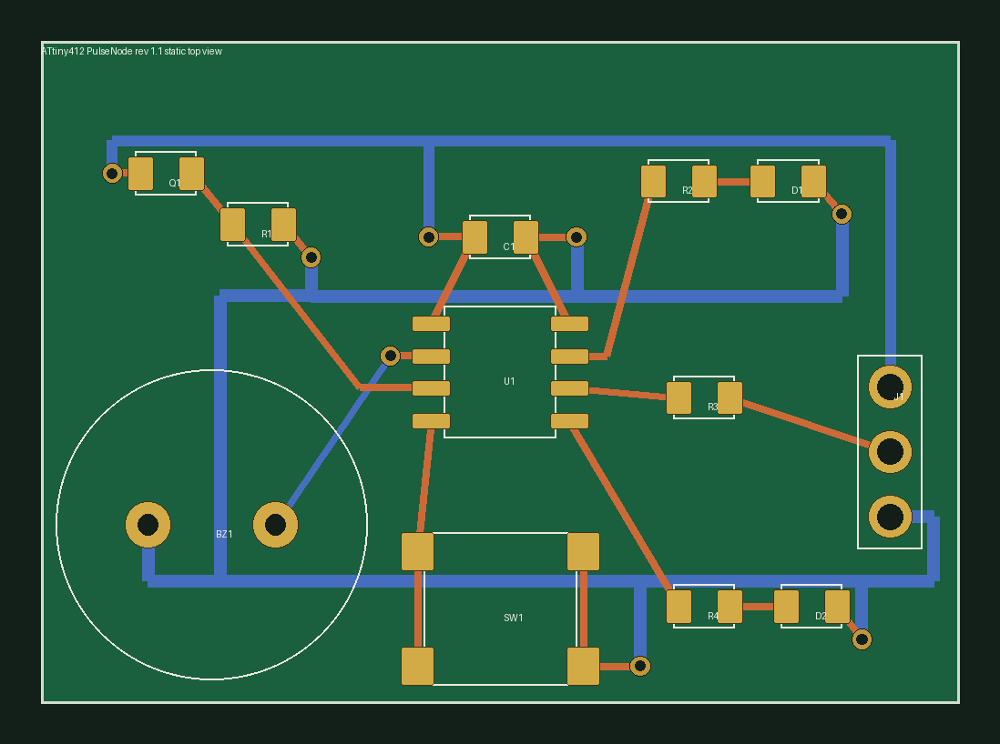

# ATtiny412 PulseNode

A compact 2-layer node built around the 8-pin ATtiny412-SSNR (SOIC-8) microcontroller: an ambient-light-driven PWM LED with a button, a status LED, and a piezo click. Designed in KiCad 8 format.

**Live inspector:** `index.html` (served by GitHub Pages at `https://aariv.me/attiny412-pulsenode/`) shows the board in 3D and 2D, the net routing status, and every download. It is generated from the KiCad file, so its numbers always match the board.

**Board readiness lab:** the same page carries a deterministic audit section (`assets/node-lab.js`, identical results in the browser and under `node --test`): an 11-net / SOIC-8 pin readiness comparator over the real `pcb.json` nets, a PWM duty and node-current curve that models all three firmware modes across the `0..1023` ADC sweep, a BOM cost audit (`$1.76` total across 12 parts on 12 line items, all 12 placed), a single cached SHA-256 readiness proof shared by the on-page fingerprint and the JSON/CSV/Markdown exports (CSV is formula-injection safe), a fail-closed `#pnlab=` state hash, and an in-page self-test runner. `npm test` runs 419 checks.

## Current state

- The `.kicad_pcb` board is `36 x 26 x 1.6 mm`, 2 copper layers, and carries all 12 BOM parts: `U1`, `C1`, `R1`, `R2`, `R3`, `R4`, `D1`, `D2`, `Q1`, `SW1`, `BZ1` and `J1`.
- All 11 named nets are routed. The local static audit reports 0 unrouted joins, 0 single-pad nets, 33 component pads, 45 track segments, 8 vias and 13 drilled holes.
- The strict local geometric audit (`tools/audit_pcb.py`) passes with a minimum unlike-net copper clearance of 0.636 mm and a minimum board-edge copper clearance of 0.700 mm. This is static evidence, not a substitute for PCBWay CAM review or KiCad's own DRC.
- The Gerbers and Excellon drill file in `gerbers/` are regenerated from the completed board. The design has not been physically fabricated or tested on real silicon, and this README does not claim otherwise.

## Hardware Overview

- **Microcontroller** ATtiny412-SSNR (SOIC-8, UPDI single-wire programming on `PA0`, header `J1`)
- **Power** 5.0V and GND through `J1`, with a 100nF 0805 ceramic capacitor (`C1`) across `VDD` (pin 1) and `GND` (pin 8)
- **Pin map** (from `firmware/attiny412_pulsenode.ino`) pin 2 `PA6` piezo, pin 3 `PA7` light input, pin 4 `PA1` button, pin 5 `PA2` status LED, pin 6 `PA0` UPDI, pin 7 `PA3` PWM LED
- **Sensor divider** `Q1` phototransistor and `R1` 10k pull-down share the `PA7_LDR` sense node
- **LED chains** `R2` feeds amber PWM LED `D1`; `R4` feeds emerald status LED `D2`
- **Programming chain** `R3` sits in series between `PA0_UPDI` and the `UPDI_HDR` contact on `J1`
- **Board Dimensions** `36 x 26 mm`, 1.6 mm thick, as measured from the KiCad outline

## Repository Structure

- `attiny412-pulsenode.kicad_pro`, `attiny412-pulsenode.kicad_sch`, `attiny412-pulsenode.kicad_pcb` KiCad 8 project, complete schematic and PCB (copies also in `pcb/`)
- `tools/generate_pcb.py` deterministic generator for the complete board layout
- `tools/generate_schematic.py` deterministic generator for the complete schematic
- `tools/audit_pcb.py` static placement, clearance, drill, BOM and connectivity audit
- `gerbers/` Gerber layers and Excellon drill file for the current board, plus `attiny412-pulsenode-gerbers.zip`
- `bom.csv` Bill of Materials with LCSC, DigiKey and Microchip part numbers
- `firmware/attiny412_pulsenode.ino` megaTinyCore sketch: the button cycles three modes (ambient auto-dimming, a breathing pulse, a blinking beacon) with a piezo click
- `cad/` 3D assembly (`.step`, `.FCStd`) of the board with envelope bodies for the parts
- `assets/`, `tools/`, `index.html` the inspector page and the script (`tools/build_assets.py`) that regenerates its data, STL, STEP, Gerbers and hashes from the KiCad file

## Interactive Schematic & PCB Viewer

Inspect the schematic and PCB online via KiCanvas:
`https://kicanvas.org/?github=https%3A%2F%2Fgithub.com%2Fdraarivpatel-ui%2Fattiny412-pulsenode`
